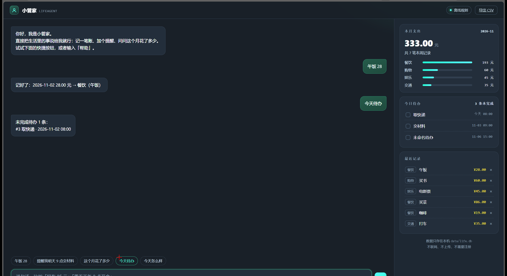

# 小管家 · LifeAgent

> 一个**本地优先、零依赖**的生活助理。记一笔账、加个提醒、问问这个月花了多少——说一句话就行。
> 数据只存在你自己电脑上的一个 SQLite 文件里，不联网、不上传、不需要注册。



```
python app.py          # 打开网页版，浏览器自动弹出
```

没有 `pip install`，没有 `npm install`，没有 Docker，没有 API Key 也能用。**只需要 Python 3.9+。**

---

## 能做什么

| 能力 | 例子 | 说明 |
|---|---|---|
| 记账 | `午饭 28` / `打车 35 元` / `昨天买书 60` | 自动识别金额、分类、日期 |
| 查账 | `这个月花了多少` / `吃饭花了多少` | 按分类汇总，自动算环比 |
| 待办 | `提醒我明天 9 点交材料` / `周五下午 3 点开会` | 支持「明天/后天/周五/3月5号 + 几点几分」 |
| 看板 | `今天待办` / `今天怎么样` | 今日待办、逾期提醒、本周/本月支出 |
| 收尾 | `完成 交材料` / `撤销上一笔` | 做完了、记错了都能改 |
| 导出 | 右上角「导出 CSV」 | 用 Excel/WPS 打开，随时带走 |

右侧是实时看板：本月支出 + 分类条形图、待办清单（逾期标红）、最近记录（可单条删除）。

---

## 快速开始

```bash
git clone https://github.com/AndersonJames0526/life-agent.git
cd life-agent

python app.py           # Windows 也可以双击 run.bat
```

浏览器会自动打开 <http://127.0.0.1:7788>。关掉终端就停，数据留在 `data/life.db`。

**终端模式**（不想开浏览器时）：

```bash
python app.py --cli
```

**自检**（改完代码跑一下，8 条指令逐条验证）：

```bash
python app.py --self-test
```

---

## 可选：接一个大模型（让说法更随意）

不开也能用。配了 API Key 之后，说「上周五那顿火锅好像记少了」这种话它也能听懂，会走工具调用而不是只聊天。

```bash
# Windows PowerShell
$env:DEEPSEEK_API_KEY = "sk-..."
python app.py

# macOS / Linux
export DEEPSEEK_API_KEY=sk-...
python app.py
```

兼容 OpenAI 接口，改这三个环境变量就能换模型：

| 变量 | 默认值 |
|---|---|
| `DEEPSEEK_API_KEY` | 空（= 纯离线规则模式） |
| `DEEPSEEK_BASE` | `https://api.deepseek.com` |
| `DEEPSEEK_MODEL` | `deepseek-chat` |

> 规则模式和大模型模式共用同一套工具函数，所以**断网、欠费、接口挂了都不会丢功能**——最差情况退回规则解析。

---

## 数据与隐私

- 数据库：`data/life.db`（SQLite，随项目目录走，删掉即清空）
- 服务只监听 `127.0.0.1`，**局域网其他设备也访问不到**（可用 `LIFEAGENT_HOST` 改，但不建议）
- 不采集、不上报、没有埋点
- 导出：`/api/export.csv`，带 BOM，Excel/WPS 直接打开不乱码

---

## 项目结构

```
life-agent/
├── app.py              # 全部后端：SQLite + 中文解析 + 工具层 + HTTP 服务（单文件，约 800 行）
├── static/
│   └── index.html      # 前端：聊天 + 看板（原生 JS，零框架，零构建）
├── docs/
│   └── screenshot.png
├── run.bat / run.sh    # 双击启动
├── data/life.db        # 你的数据（.gitignore 已排除）
└── app.py --self-test  # 8 条指令的自检
```

三个文件就能跑起来：`app.py` + `static/index.html` + Python 本身。

---

## 一些设计取舍

- **不用 Flask / FastAPI**：为了「下载就能跑」，用标准库 `http.server` + `sqlite3`，省掉虚拟环境这一关。
- **不用前端框架**：一个 HTML 文件，改样式不用重新构建。
- **规则优先，模型兜底**：记账这类高频、低歧义的指令，正则比大模型快 100 倍、且 100% 稳定；只有真正含糊的话才值得调用模型。
- **数据是文件**：不搞账号体系，不搞云同步。想备份就复制 `data/`，想多设备就丢网盘。

## 已知限制

- 中文解析是规则式：只认常见说法，过于口语化（「今儿个中午那碗面」）需要开大模型模式。
- 只做了单用户、单机；多设备同步没做（也不想做）。
- 金额只支持人民币数字，没有多币种。

## 路线图

- [ ] 预算与超支提醒（设「餐饮 1500/月」，超了主动提示）
- [ ] 订阅/账单周期识别（房租、会员到期提醒）
- [ ] 周报：一句话总结这一周的钱和时间花在哪
- [ ] 手机端 PWA（加个 manifest + service worker）
- [ ] 导入微信/支付宝账单 CSV

---

## 贡献

Issue / PR 都欢迎。改完代码请先跑：

```bash
python app.py --self-test
```

## License

[MIT](LICENSE) — 随便用，随便改，商用也行。
